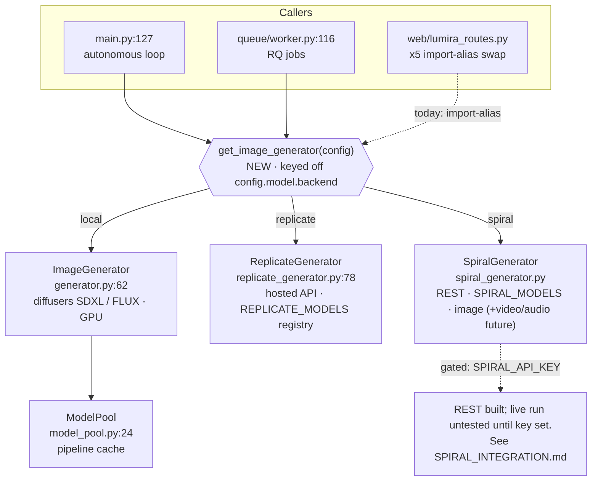

# Generator Backends

Snapshot as of 2026-07-28. Source: `src/ai_artist/core/`, `web/lumira_routes.py`, `queue/worker.py`.

Lumira's generation stage is duck-typed: any class exposing
`generate(prompt, ...) -> list[PIL.Image]` (plus `load_model()` / cleanup) can stand in.
Two concrete backends exist today; a hosted multi-model backend (Spiral) is the third.

## Backend interface (duck-typed — no ABC yet)

| Method | local `ImageGenerator` | `ReplicateGenerator` | `SpiralGenerator` |
|--------|------------------------|----------------------|-----------------------------|
| `generate(prompt, ...) -> list[Image]` | ✅ `generator.py:471` | ✅ `replicate_generator.py:142` | ✅ `spiral_generator.py` |
| `load_model()` | ✅ | ✅ | ✅ no-op (remote) |
| budget guard | n/a (local) | `_check_replicate_budget:52` | `_check_spiral_budget` |
| model registry | `MoodModelConfig` `config.py:26` | `REPLICATE_MODELS:20` | `SPIRAL_MODELS` |

## Selection

`config.model.backend` (`local` \| `replicate` \| `spiral`, added 2026-07-28, default
`"local"`) selects the backend via `get_image_generator()` in `core/generator_factory.py`.
Studio/web create paths use `build_web_image_generator()` (2026-07-29): Spiral-first when
keys exist and backend is still `local`. Worker uses the factory directly. CLI
`main.py` stays on local ImageGenerator. `spiral` requires `SPIRAL_API_KEY`; see
SPIRAL_INTEGRATION.md. Audio/video use `spiral_media.py` (not the image factory).
